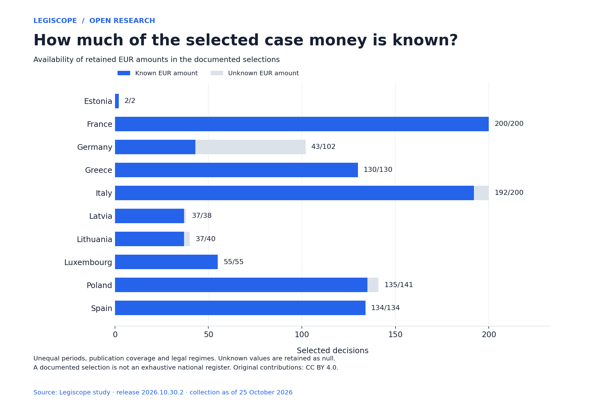

# European privacy fines: data, sources and reproducible analysis

**1,042 documented decisions · 10 countries · source collection as of 25 October 2026**

Open research by [Legiscope](https://www.legiscope.com/). Download the case records, inspect their official source links, reproduce the calculations and reuse the country extracts and charts.

**[Read the study and explore the decisions →](https://www.legiscope.com/blog/europe-data-protection-fines-per-capita.html)**

[Download this version](https://github.com/legiscope/gdpr-data-study/archive/refs/tags/v2026.10.30.2.zip) · [Methodology](docs/methodology.md) · [Data dictionary](docs/data-dictionary.md) · [Publication packages](publication/README.md) · [Cite this dataset](CITATION.cff)

## What the data covers

The collection contains up to 200 documented decisions per country, selected from the available records. It includes GDPR, cookie and related national data-protection enforcement. The national sources cover different periods and publish different levels of detail. It is a documentary collection, not a census of national sanctions or a harmonized measure of enforcement intensity.

| Country | Decisions | Known EUR amounts | Unknown EUR amounts |
|---|---:|---:|---:|
| France | 200 | 200 | 0 |
| Germany | 102 | 43 | 59 |
| Spain | 134 | 134 | 0 |
| Lithuania | 40 | 37 | 3 |
| Poland | 141 | 135 | 6 |
| Latvia | 38 | 37 | 1 |
| Italy | 200 | 192 | 8 |
| Estonia | 2 | 2 | 0 |
| Luxembourg | 55 | 55 | 0 |
| Greece | 130 | 130 | 0 |
| **Total** | **1,042** | **965** | **77** |

## Download the data

| File | Contents |
|---|---|
| [data/cases.csv](data/cases.csv) | All case records, including dates, currencies, amounts, findings, appeal notes and source links |
| [data/cases.json](data/cases.json) | The same case records with native arrays, objects and null values |
| [data/dataset.json](data/dataset.json) | Byte-identical published snapshot: cases, country summaries, themes and coverage notes |
| [data/country-summary.csv](data/country-summary.csv) | Decision counts, population, monetary coverage, totals and amounts per resident |
| [data/countries/](data/countries/) | Separate CSV and JSON extracts for all ten countries |
| [data/themes.csv](data/themes.csv) | The original classification dictionary |
| [data/case-themes.csv](data/case-themes.csv) | One case–theme pair per row, for counting findings |
| [data/source-coverage.csv](data/source-coverage.csv) | Availability of amounts by country and recorded source level |
| [data/sources.csv](data/sources.csv) | Deduplicated links cited in the records and country summaries |

CSV files use UTF-8 with a byte-order mark. Arrays and objects are JSON strings in CSV cells. Blank CSV cells mean absent or null values; use JSON when that distinction matters. Strings that could execute as spreadsheet formulas are prefixed with an apostrophe.

## Reproduce the analysis

Python 3.9 or later is sufficient; no installation or network access is needed for the data build.

```bash
git clone https://github.com/legiscope/gdpr-data-study.git
cd gdpr-data-study
python3 scripts/build.py
python3 scripts/build.py --check
```

The builder verifies the frozen snapshot hash, unique IDs, country counts, monetary coverage, country totals, population ratios and the generated exports. It executes the cells in [notebooks/study.ipynb](notebooks/study.ipynb) and stores their actual outputs. It reproduces analysis of this snapshot; it does not recollect regulator websites or redo the legal review.

To regenerate the charts, install the plotting dependency in a virtual environment, then run:

```bash
python3 -m venv .venv
.venv/bin/python -m pip install -r requirements-charts.txt
.venv/bin/python scripts/charts.py
python3 scripts/build.py
python3 scripts/build.py --check
```

To create the downloadable data bundle and platform ZIPs locally:

```bash
python3 scripts/build.py --package
```

## Reusable charts



[Amount coverage: SVG](charts/amount-coverage.svg) · [Documented amounts per resident: SVG](charts/amounts-per-resident.svg) · [French case themes: SVG](charts/france-themes.svg)

All charts include the data version, source attribution and coverage limits. PNG equivalents are available in [charts/](charts/).

## How the per-resident figure is calculated

```text
sum of documented retained EUR amounts in the selected cases
──────────────────────────────────────────────────────────
         population on 1 January 2026
```

The numerator uses the case-level `amount_eur` values, including the documented adjustments retained in this snapshot. Missing or non-convertible amounts remain null, never zero. Amounts are rounded to cents at case level before summation. PLN conversions use the recorded daily ECB rate. Population comes from Eurostat.

**The figure is not an annual rate, a probability of receiving a fine, an amount paid by residents or a ranking of national enforcement severity.** Periods, publication coverage, legal regimes and known appeal stages differ. Initial amounts and known revisions are not all final or paid. Theme coding also differs in depth; compare its frequencies within a documented country selection, not across countries.

Never sum monetary amounts after joining the multi-label `case-themes.csv` table: that would count multi-theme decisions repeatedly. Use `country-summary.csv` for the reproduced country totals.

## Publish and cite

The [publication folder](publication/README.md) contains data.gouv.fr resources, Datawrapper/Flourish chart data, a Kaggle dataset template, a Hugging Face dataset card and files, and Zenodo metadata. Each destination still needs its account-side import and review; their presence here does not establish publication on those platforms.

Suggested attribution:

> Legiscope, *European privacy fines: documented decisions and amounts per resident*, version 2026.10.30.2, collection as of 25 October 2026. [Study and methodology](https://www.legiscope.com/blog/europe-data-protection-fines-per-capita.html). Original contributions licensed CC BY 4.0. State any changes when reusing.

Use the article URL when citing the study and the [versioned repository](https://github.com/legiscope/gdpr-data-study/tree/v2026.10.30.2) when identifying this exact data release. Machine-readable citation metadata is in [CITATION.cff](CITATION.cff).

## Provenance, corrections and licences

[provenance.json](provenance.json) records the source version, original source commit and SHA-256. [checksums.json](checksums.json) identifies the release files. [source/](source/) preserves the original input manifest, published audit notes and Greek inclusion/exclusion journal.

The snapshot was checked against the public study data on 30 October 2026. Later corrections to the website do not change this frozen version. Report a correction through a [GitHub issue](https://github.com/legiscope/gdpr-data-study/issues/new), including the case ID, the official source and the proposed change. A correction should receive a new version and changelog entry.

Original data selection, structure, annotations, summaries and charts: **[CC BY 4.0](LICENSE-DATA)**. Original software: **[MIT](LICENSE)**. Regulator decisions, linked documents, Eurostat/ECB data and third-party marks retain their own terms. Full decision texts and regulator PDFs are not bundled. See [LICENSING.md](LICENSING.md).
